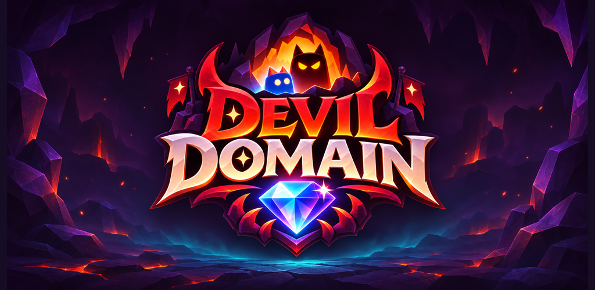
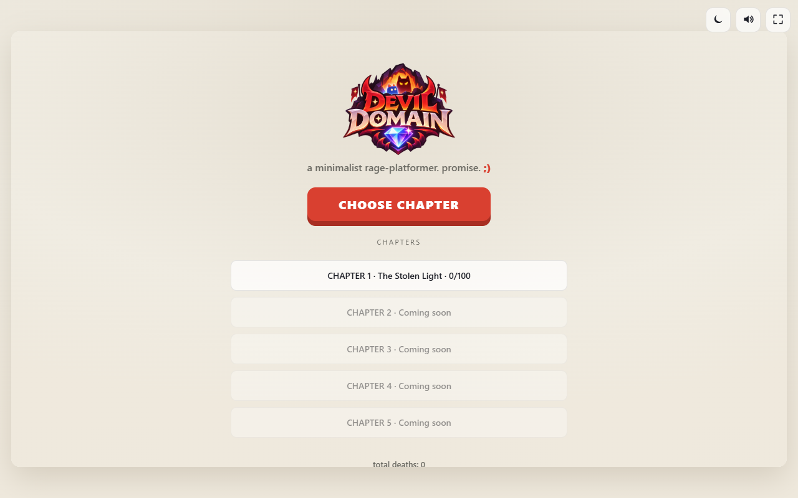
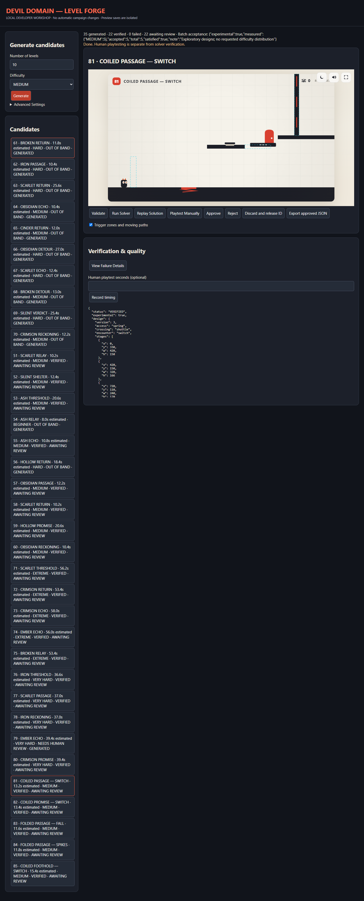
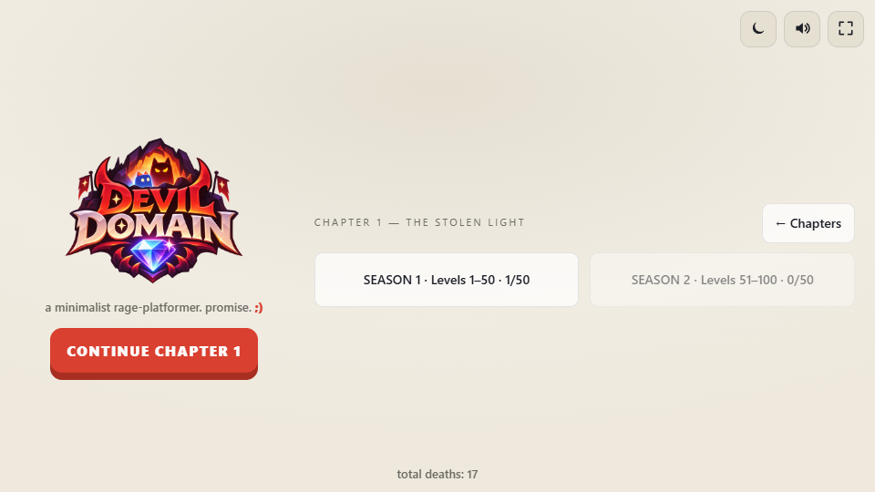
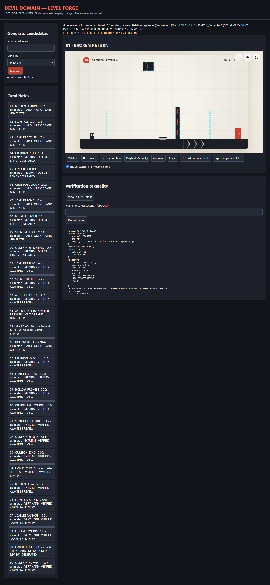
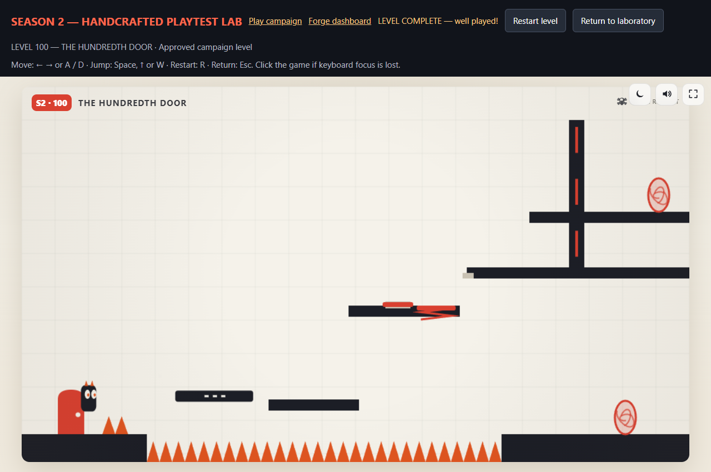

<p align="center">
  
</p>

# Devil Domain 🎮

> **A high-octane 50-level Canvas rage-platformer featuring procedural audio synthesis, pixel-precise physics simulation, dual light/dark aesthetics, sequential level unlocks, interactive Level Forge workshop, and cross-platform Capacitor Android deployment.**

[](#)
[](#)
[](#)
[](#)
[](LICENSE)

---

## 📸 Visual Showcase & Dashboard View

### 🖥️ Main Game Dashboard & Menu Interface
*Full high-definition title screen with instant mode navigation, season progress tracking, and theme selection:*
<p align="center">
  
</p>

### 🕹️ Real-Time Physics & Gameplay Engine Interface
*Precision tile physics, active collision detection, hazard zones, and real-time HUD metrics:*
<p align="center">
  
</p>

### 🗺️ Campaign Progression & Season Chapter Selection
*Multi-season level selection architecture supporting seamless progression from Season 1 through Season 2:*
<p align="center">
  
</p>

### 🌓 Responsive Rage-Platforming Mechanics
*Fine-tuned jump physics, wall-slides, obstacle patterns, and dark/light mode responsiveness:*
<p align="center">
  
</p>

### 🏆 100% Campaign Completion & Achievement Milestone
*End-to-end simulation verified replay proofs and automated zero-death input playback:*
<p align="center">
  
</p>

---

## About The Project

A lightweight Canvas rage-platformer with procedural audio, local saves, dark/light themes and a Capacitor Android wrapper. The existing engine and campaign are preserved. See [EXPANSION_V2.md](docs/EXPANSION_V2.md) for current evidence and walkthroughs. [AUDIT_REPORT.md](AUDIT_REPORT.md) records the earlier 30-level audit.

## Run and test

```powershell
npm ci
npm start
npm test
npm run test:browser
```

Open http://localhost:8080 after starting the server. index.html also works directly; local HTTP is preferred for consistent storage. npm start uses npx serve and may download that development tool on first use. The game itself makes no network requests.

Arrows/A,D move; Space/Up/W jump; R restart; Escape menu; M mute; T theme; F browser fullscreen. Mobile has floating movement/jump/restart controls. PLAY resumes the first unfinished level. The developer grid currently selects all 40 levels without changing saves. Android Back returns to the menu. Backgrounding clears input and pauses simulation; returning starts a fresh frame clock.

## Android

See [ANDROID_BUILD.md](ANDROID_BUILD.md) for reproducible build, installation, signing and device checks. The Android platform already exists. App ID: com.janawad.devildomain; minimum SDK 24; target/compile SDK 36. APK and unsigned AAB builds succeeded; device and emulator execution are unverified.

## Test coverage

- game.js: existing engine, 40 levels and traps; fixed-step simulation.
- scripts/build.js: runtime/license copy to www for Capacitor.
- tests/run-tests.js: 45 legacy static/copied-logic checks retained for continuity.
- tests/gameplay.test.js and harness.js: 55 checks executing actual game source with mocked DOM, storage and audio, including 40 simulation/reset checks.
- tests/browser-smoke.js: real headless Chrome rendering, level 1 movement to exit, reload persistence, pause/resume and small landscape menu checks.
- test-results/: logs and screenshots.

Schema/simulation checks do not prove every level completable. All levels still need device playtesting. Levels 30–40 have zero-death input replay proofs; levels 2–29 still need full route verification. This is not a production-readiness claim.

## License

MIT — [LICENSE](LICENSE). Original engine attribution to FableDevil (copyright 2026 Leonxlnx) remains in source and the bundled license, outside player-facing UI. Capacitor notices are in [THIRD_PARTY_NOTICES.txt](THIRD_PARTY_NOTICES.txt) and bundled Android assets. See the audit for provenance review limitations.

## Developer and production modes

game-config.js explicitly enables DEVELOPER_UNLOCK_ALL_LEVELS in development. Set it to false to test genuine sequential unlocks locally. The menu labels developer access; selecting levels never fabricates completion data.

Use `npm run build:release` for a production web bundle or `npm run cap:sync:release` for production Android assets. Native release builds additionally regenerate a locked asset overlay, overriding a developer sync automatically. Debug APKs keep developer access. Never deploy source/development assets as a production web build.

`npm test` now passes 119 checks (45 legacy plus 74 runtime/configuration checks). `npm run test:browser` runs smoke/multitouch checks and keyboard-input playthroughs of levels 30–40. See docs/LEVEL_INVENTORY.md for the existing campaign inventory.

## Level Forge (50-level campaign)

Run `npm run forge` and open http://127.0.0.1:8091 for the local developer workshop. Levels 41–50 are integrated with fresh simulation and browser replay proofs. See [Level Forge guide](docs/LEVEL_FORGE.md) and [current results](docs/FORGE_RESULTS.md). Earlier 40-level counts above describe the V2 milestone; the current campaign has 50 levels. All 40 original definitions are preserved. `npm test` includes Forge tests.
